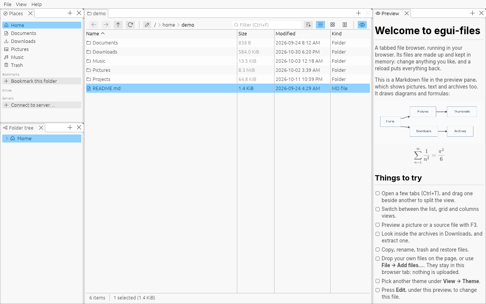
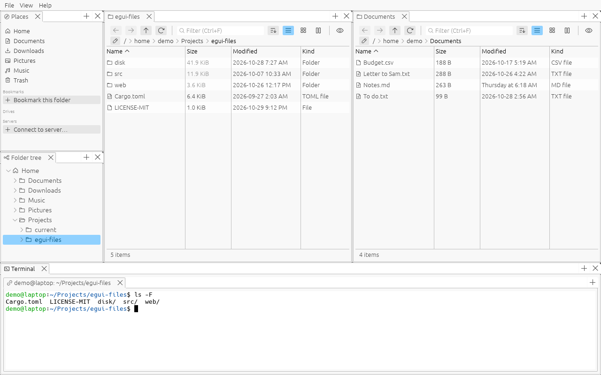
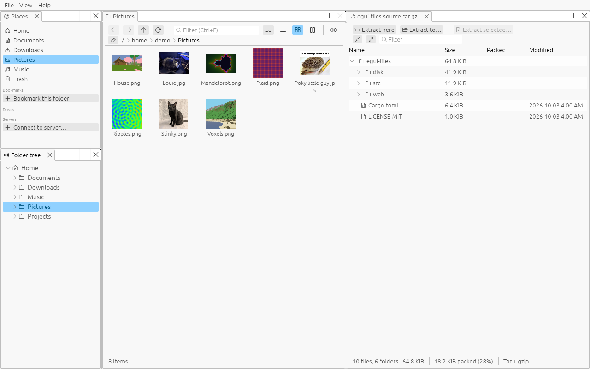
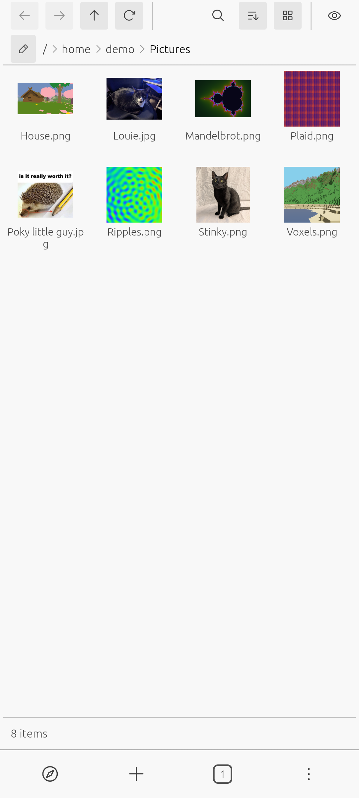

# egui-files

A tabbed file browser for Linux, Windows and Android, written in Rust with
[egui](https://github.com/emilk/egui). Tabs split side by side, a preview
pane, archives opened like folders, a terminal that follows along, and
themes. It also runs in the browser, as a demo.

<picture>
  <source media="(prefers-color-scheme: dark)" srcset="docs/screenshots/markdown-dark.png">
  
</picture>

> **AI disclosure:** all of this project's code, tests and documentation
> were written by an AI model, Anthropic's Claude (through Claude Code),
> at my direction, as were the fixes in our [forks](#forks). The libraries
> it uses are their authors' own. I decide what gets built and how it
> should behave, and try it on my own machines and phone.

**[Try it in your browser](https://thenoswad.github.io/egui-files/)**, or
[download it](#downloads).

## Features

- **Tabs and panes:** drag tabs beside or below each other, or out into
  windows of their own. Places, the folder tree, the preview and the
  terminal are panes too.
- **Views:** details, a grid of thumbnails, and columns, with folder sizes.
- **Preview:** pictures (with EXIF), text and source code highlighted,
  Markdown, videos, and what's inside archives.
- **Archives:** browse zip, 7z, tar (gzip, bzip2, xz, zstd) and RAR like
  folders, and extract them; make zip, 7z and tar archives, zip and 7z with
  a password.
- **Markdown:** a viewer and editor with math, Mermaid diagrams, tables and
  pictures; edit the rendered page itself, and links follow files you move
  or rename.
- **Terminal:** follows the folder you're in, and onto servers over ssh.
- **Video:** play videos, and cut clips from them: trim, crop, resize, change
  the speed and volume, or make a GIF, to a size limit if you want.
- **Places:** drives (and ejecting them), servers over SFTP, and phones
  through KDE Connect.
- **The rest:** copy, move, trash and restore with a jobs bar, disk usage,
  properties and permissions, "Open with", themes and a theme editor, and a
  mobile layout.

<table>
  <tr>
    <td width="50%">
      <picture>
        <source media="(prefers-color-scheme: dark)" srcset="docs/screenshots/split-dark.png">
        
      </picture>
      Tabs side by side, and a terminal that follows along.
    </td>
    <td width="50%">
      <picture>
        <source media="(prefers-color-scheme: dark)" srcset="docs/screenshots/archive-dark.png">
        
      </picture>
      Thumbnails, beside an archive's contents.
    </td>
  </tr>
</table>

<p align="center">
  <picture>
    <source media="(prefers-color-scheme: dark)" srcset="docs/screenshots/phone-dark.png">
    
  </picture>
  <br>
  The mobile layout, as on Android.
</p>

## Downloads

From the [nightly release](https://github.com/TheNoswad/egui-files/releases/tag/nightly),
built from `main` on every change. There are no versioned releases yet, and
this is early software. Of these builds, only the Linux x86-64 AppImage has
been tried on a real machine so far; the others are built but untested.

| | |
|---|---|
| Linux | `.AppImage`: make it executable (`chmod +x`) and run it. Or the `.tar.gz`, with the bare program. x86-64 and arm64. |
| Windows | `.zip`: unzip and run `egui-files.exe`. Windows warns about an unknown publisher the first time: **More info** → **Run anyway**. x86-64 and arm64. |
| Android | `.apk`: `arm64` for phones, `x86_64` for emulators and Chromebooks. Allow installing from your browser or file manager when asked, then "All files access" for the app. |

## Platforms

| | |
|---|---|
| Linux | Wayland and X11. Phones need [KDE Connect](https://kdeconnect.kde.org/). |
| Windows | x86-64. |
| Android | arm64, Android 11 and up, with "All files access". |
| Web | A demo with made-up files, kept in memory. No terminal, video, RAR or zstd. |

macOS isn't supported.

For videos the app uses [mpv](https://mpv.io/) (libmpv) to play them and
[ffmpeg](https://ffmpeg.org/) to cut them, when they're installed. It offers
to download ffmpeg, and libmpv on Windows.

## Building

You need [Rust](https://rustup.rs/) and a C and C++ compiler (unrar, zstd
and Oniguruma are built from source).

```sh
cargo run --release
```

The rest:

- **Windows from Linux:** `rustup target add x86_64-pc-windows-gnu`, the
  MinGW-w64 toolchain, then `cargo build --release --target x86_64-pc-windows-gnu`.
- **Android:** with the Android SDK and NDK and
  [cargo-apk](https://github.com/rust-mobile/cargo-apk), run
  `cargo apk build --release` in `android/`.
- **Web:** with [trunk](https://trunkrs.dev/) and
  `rustup target add wasm32-unknown-unknown`, `web/build.sh` builds the
  landing page and the demo into `target/site`.

## Working on it

- `git config core.hooksPath .githooks` turns on the pre-commit hook. It
  checks formatting, runs clippy for Linux, Windows and the web with
  warnings as errors, runs the tests, and checks dependencies with
  [cargo-deny](https://github.com/EmbarkStudios/cargo-deny).
- `scripts/screenshots.sh` takes the screenshots above, and the landing
  page's, from the app itself.
- CI (`.github/workflows/ci.yml`) runs the same checks on every push, and
  on `main` builds every platform, cross-compiled on Linux, with
  `scripts/package.sh`, for the nightly release.
- `scripts/upstream.sh` reports on what we're waiting for upstream: issues,
  new releases, and our forks.
- [TODO.md](TODO.md) has what's planned, and [CHANGELOG.md](CHANGELOG.md)
  what's done.

### Forks

A few crates have fixes of ours that aren't in a release yet. They come
from branches of forks under
[github.com/TheNoswad](https://github.com/TheNoswad), one commit each on top
of the release, through `[patch.crates-io]` in `Cargo.toml`. Cargo fetches
them by itself.

| Crate | Fix |
|---|---|
| egui-winit | One Wayland clipboard shared between windows, and Ctrl+V passed on when there's no text to paste |
| unrar_sys | Building for the target rather than the host (Windows and Android), and no crash on older x86 CPUs |
| mermaid-rs-renderer | Running in the browser, no font cache, and measuring text with the font it's drawn in |

## License

MIT OR Apache-2.0, at your option: see [LICENSE-MIT](LICENSE-MIT) and
[LICENSE-APACHE](LICENSE-APACHE). RAR archives are read with unrar, whose
own license allows extracting but not making a RAR compressor from it.
