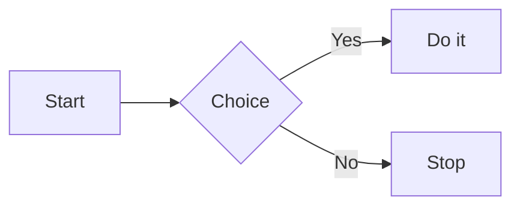
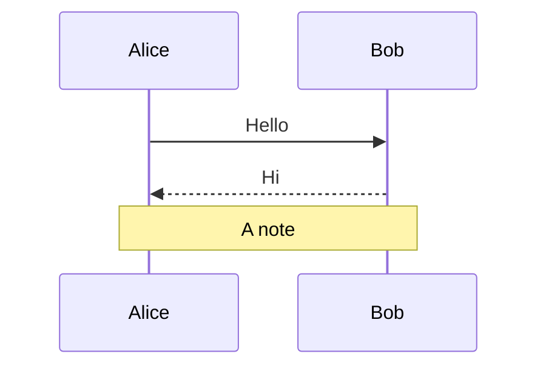
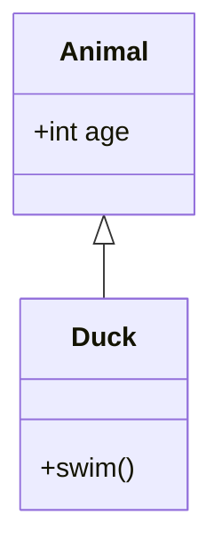
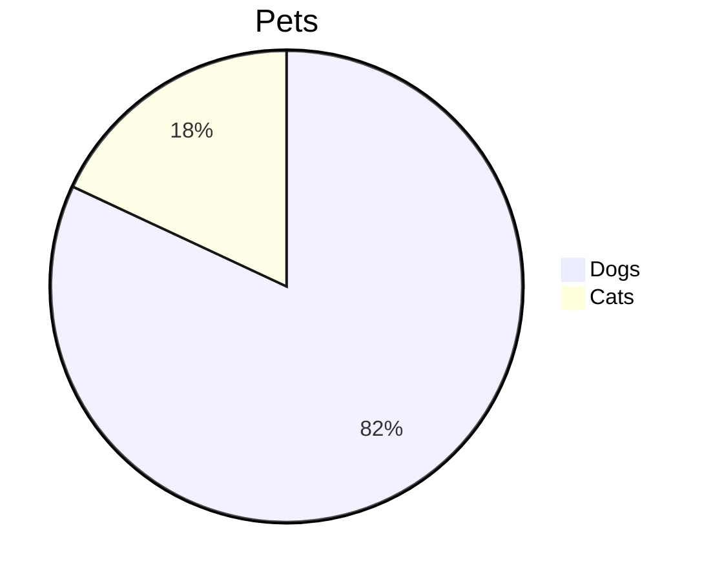

# Markdown showcase

Everything the renderer handles, plus edge cases that tend to break renderers. The block above is YAML frontmatter, which should show as a small table of fields. Each section says what to look for.

**Jump to:** [Text](#inline-text) · [Headings](#headings) · [Lists](#lists) · [Quotes](#quotes) · [Callouts](#alerts-and-callouts) · [Code](#code) · [Tables](#tables) · [Images](#images) · [Links](#links) · [Notes](#obsidian-style-notes) · [Footnotes](#footnotes) · [Not rendered yet](#not-rendered-yet) · [Stress](#stress)

## Inline text

Plain, **bold**, __bold again__, *italic*, _italic again_, ***bold italic***, **bold with *italic* inside**, *italic with **bold** inside*, ~~struck~~, and `inline code`.

Formatting combined: **`bold code`**, *`italic code`*, ~~`struck code`~~, ~~**struck bold**~~, [**bold link**](#inline-text), [`code link`](#inline-text), and [*italic link*](#inline-text).

Scripts: H~2~O, CO~2~, x^2^, E = mc^2^, ~at the edge~ and ^at the edge^. These should stay plain: a~b c~d, 2^3 4^5.

Highlights: ==one highlight==, ==**bold** highlight==, and ==several words with `code` in them==. These should stay plain: `==code==`, x == y, a === b, ==unclosed.

### Line breaks

A soft break, where the line ends
without two spaces, should join into one line.

A hard break, with two spaces,  
should start a new line.

A hard break, with a backslash,\
should too.

### Escapes and entities

Escaped characters should show as written: \*not italic\*, \`not code\`, \[not a link\](x), \# not a heading, \\ one backslash, \~\~not struck\~\~.

Entities: &amp; &lt; &gt; &copy; &mdash; &frac12; &#35; &#x1F680;

### Characters

Accents: café, naïve, Zürich, São Paulo, Ångström. Combining: e&#x301; n&#x303;.
Symbols: → ← ↑ ↓ ✓ ✗ • … — – € £ ¥ © ® ™ ° ± × ÷ ≠ ≤ ≥ ∞.
Greek and Cyrillic: αβγδ λμπσω, Привет мир.
Fonts rarely cover these, so missing glyphs show up here: 日本語のテキスト, 中文文本, 한국어 텍스트, שלום עולם, مرحبا بالعالم.
Emoji typed directly: 🚀 🎉 👍 ❤️ 🇯🇵.

## Headings

# Heading level 1
## Heading level 2
### Heading level 3
#### Heading level 4
##### Heading level 5
###### Heading level 6

Setext heading, level 1
=======================

Setext heading, level 2
-----------------------

## A heading with **bold**, *italic* and `code`

## Same name

## Same name

The two above get different anchors: [first](#same-name) and [second](#same-name-1).

## Custom anchor {#my-anchor}

[Jump to the custom anchor](#my-anchor).

## A very long heading that has to wrap around the width of the page, because it just keeps going and going for quite a while

## Lists

Bullets, three levels, each with its own marker:

- First
- Second
  - Nested
    - Nested twice
      - Nested three times
- Third, which is long enough that it has to wrap, so you can check that the wrapped lines line up with the start of the text and not with the bullet

Other bullet markers: `*` and `+`.

* Star
* Star

+ Plus
+ Plus

Numbered:

1. One
2. Two
   1. Two point one
   2. Two point two
3. Three

Starting elsewhere, with wide numbers:

98. Ninety-eight
99. Ninety-nine
100. A hundred
101. A hundred and one

Loose, with paragraphs and blocks inside the items:

1. The first item has a paragraph.

   And then a second one.

2. The second item has code:

   ```python
   print("in a list")
   ```

3. The third has a quote:

   > Quoted in a list.

4. The fourth has a table:

   | a | b |
   |---|---|
   | 1 | 2 |

Tasks (click them: only the mark in the source should change, and the tab should go dirty):

- [ ] Open
- [x] Done
- [X] Done, with a capital
- [ ] With **formatting**, `code` and a [link](#lists)
- [ ] Parent
  - [x] Child done
  - [ ] Child open
    - [ ] Grandchild

1. [ ] A numbered task
2. [x] Another

Definition lists:

Apple
: A fruit.
: A company.

Term with **bold**
: A definition that goes on long enough to wrap around the width of the page, so you can see how it lines up on the next line.

Items that start with formatting, and empty ones:

-
- After an empty item
- `code first`
- **bold first**
- *italic first*
- ~~struck first~~
- [link first](#lists)
-  picture first
- https://example.com/bare-url-first

## Quotes

> A plain quote, which goes on long enough that it has to wrap around the width of the page, so the bar has to run down beside every line.
>
> With a second paragraph.

> A quote
> > with a quote in it
> > > and another
>
> and back out.

> A quote holding other blocks:
>
> ## A heading
>
> - A list
> - [ ] A task
>
> ```rust
> let code = "in a quote";
> ```
>
> | a | table |
> |---|-------|
> | 1 | 2     |

## Alerts and callouts

GitHub's five alerts:

> [!NOTE]
> Useful information.

> [!TIP]
> Helpful advice.

> [!IMPORTANT]
> Key information.

> [!WARNING]
> Needs attention.

> [!CAUTION]
> Risks and negative outcomes.

With a title, and folding. The first starts closed, the second starts open, and both should toggle when clicked:

> [!tip]- Closed at first
> This was hidden until you opened it.

> [!info]+ Open at first
> This can be closed.

Obsidian's other kinds, each with its own icon or color:

> [!abstract] Abstract
> Text.

> [!todo] To do
> Text.

> [!success] Success
> Text.

> [!question] Question
> Text.

> [!failure] Failure
> Text.

> [!danger] Danger
> Text.

> [!bug] Bug
> Text.

> [!example] Example
> Text.

> [!quote] Quote
> Text.

> [!somethingelse] An unknown kind looks like a note
> Text.

> [!warning] Holding other blocks
> A paragraph, with **bold**.
>
> - A list
>
> ```sh
> echo "code in a callout"
> ```
>
> > [!note] A callout in a callout
> > Nested.

> [!warning]

The one above has a title and no body. These aren't callouts, so they stay plain quotes:

> [not one]

> [!not one]

## Code

Each of these should be highlighted. Hover over one for the copy button.

```rust
use std::collections::HashMap;

/// Counts the words.
fn count(text: &str) -> HashMap<&str, usize> {
    let mut counts = HashMap::new();
    for word in text.split_whitespace() {
        *counts.entry(word).or_insert(0) += 1;
    }
    counts
}
```

```python
def greet(name: str = "world") -> str:
    # A comment
    return f"Hello, {name}!"
```

```js
const double = (n) => n * 2;
console.log([1, 2, 3].map(double));
```

```json
{ "name": "egui-files", "tags": ["a", "b"], "count": 3, "ok": true }
```

```html
<!-- Inside a fence this is code, not raw HTML -->
<div class="x">Hello</div>
```

```sh
for f in *.md; do echo "$f"; done
```

```toml
[package]
name = "demo"
```

```diff
- removed
+ added
```

An unknown language and no language, which should stay plain:

```nosuchlanguage
just text
```

```
no language at all
```

Indented, by four spaces:

    indented code
      keeps its indent

A long line, which should scroll sideways rather than wrap:

```
this line is much much much much much much much much much much much much much much much much much much much much much much much much much much much much much much longer than the page
```

Markdown inside a fence stays as written:

````markdown
```rust
let nested = "fence";
```
**not bold**
````

A tilde fence and an empty block:

~~~rust
let tilde = true;
~~~

```
```

## Tables

Alignment, with formatting in cells:

| Left | Center | Right | Default |
|:-----|:------:|------:|---------|
| a | b | 1 | x |
| longer text here | **bold** | 22 | *italic* |
| `code` | ~~struck~~ | 333 | [link](#tables) |
| ==highlight== | :rocket: | 4,444 | H~2~O |
|  | a \| pipe | | empty beside |

Missing cells, and extra ones the header doesn't have:

| One | Two | Three |
|-----|-----|-------|
| 1 |
| 1 | 2 |
| 1 | 2 | 3 | 4 |

Long text, which should wrap inside its column:

| Name | Description |
|------|-------------|
| Short | This description goes on for long enough that it can't fit on one line beside the name, so it has to wrap inside its column instead of making the table wider than the page. |
| Other | Short. |

Too many columns to fit, which should scroll sideways:

| Column one | Column two | Column three | Column four | Column five | Column six | Column seven | Column eight | Column nine | Column ten | Column eleven | Column twelve |
|------------|------------|--------------|-------------|-------------|------------|--------------|--------------|-------------|------------|---------------|--------------|
| 1 | 2 | 3 | 4 | 5 | 6 | 7 | 8 | 9 | 10 | 11 | 12 |
| a | b | c | d | e | f | g | h | i | j | k | l |

A single column:

| Alone |
|-------|
| 1 |
| 2 |

## Images

A picture smaller than the page, with a title (hover over it):


A picture wider than the page, which should scale down:


Inline, in the flow of the text:  between words  and at the end 

Several in a row that wrap:          

A linked picture, which should open the page when clicked:

[](https://example.com "Goes to example.com")

A name with a space in it: 

Missing, which should show its description: 

Not a picture, which should show its description too: 

Remote, which shouldn't load until you click **Load** at the top of the document (Settings → Markdown changes this):


## Links

Web: [with text](https://example.com), [with a title](https://example.com "A title"), <https://example.com>, <mail@example.com>, [mail link](mailto:mail@example.com).

Bare addresses, which GitHub turns into links: https://example.com/bare, www.example.com, (https://example.com/in-parens), and https://en.wikipedia.org/wiki/Rust_(programming_language). These stay as text: `https://example.com/code`, xhttps://example.com.

Reference style: [by label][ref], [case-insensitive][REF], [the shortcut], and a [missing one][nope], which stays as text.

[ref]: https://example.com/reference "Reference title"
[the shortcut]: https://example.com/shortcut

In this document: [to the top](#markdown-showcase), [a heading with formatting](#a-heading-with-bold-italic-and-code).

Other documents, followed in this tab (Back and Forward come back; Ctrl+click opens a new tab):

- [Another document](other.md)
- [At a heading in it](other.md#a-section)
- [In a subfolder, with a space](notes/a%20note.md)
- [Doesn't exist](missing.md), which should say so

Other files:

- [A text file](notes.txt) opens with its app
- [A program](run.sh) is shown in its folder rather than run
- [A folder](pics) is shown too

Refused, as they could do harm:

- [javascript](javascript:alert(1))
- [a custom scheme](steam://run/1)

## Obsidian-style notes

Wikilinks: [[other]], [[other|with its own text]], [[other#A section|at a heading]], [[a note]] (found in a subfolder), and [[No such note]], which should say it doesn't exist.

Tags: #tag, #tag-with-dash, #nested/tag, and #tag2. These aren't tags: #123, a#b, and `#code`.

Emoji shortcodes: :rocket: :tada: :+1: :smile: :warning: :white_check_mark:. These stay as written: :not_an_emoji:, 10:30:15, and `:rocket:`.

## Footnotes

A short note[^short], one with blocks in it[^long], and the short one again[^short]. Named ones work too[^named-note]. They're numbered in the order they're first used, wherever they're written, and each has an arrow back.

[^short]: The short note.

[^long]: The first paragraph of a long note.

    The second paragraph.

    ```rust
    let code = "in a footnote";
    ```

[^named-note]: A note with **formatting**, and a [link](#footnotes).

[^unused]: Nothing refers to this one, so it goes last.

## Math

Inline math: $e^{i\pi} + 1 = 0$, and $\frac{a}{b}$ in a sentence, with tall ones like $\sum_{n=1}^{\infty} \frac{1}{n^2}$ keeping to the line. Not math: it costs \$5 or \$10.

A heading takes its color and size:

### The area under $x^2$

Display math:

$$
\int_0^1 x^2 \, dx = \frac{1}{3}
$$

$$
\begin{aligned}
a &= b + c \\
d &= e + f
\end{aligned}
$$

With a tag, against the right edge:

$$
\tag{1} E = mc^2
$$

Wider than the page, which scrolls sideways:

$$
a_1 + a_2 + a_3 + a_4 + a_5 + a_6 + a_7 + a_8 + a_9 + a_{10} + a_{11} + a_{12} + a_{13} + a_{14} + a_{15} + a_{16} + a_{17} + a_{18} + a_{19} + a_{20} + a_{21} + a_{22} + a_{23} + a_{24} + a_{25} + a_{26} + a_{27} + a_{28} + a_{29} + a_{30}
$$

In a table:

| Name | Formula |
|------|---------|
| Pythagoras | $a^2 + b^2 = c^2$ |
| Euler | $e^{i\pi} + 1 = 0$ |

What can't be drawn shows its source: inline in red, $\nosuchcommand$, and in display math with why:

$$
\nosuchcommand{x}
$$

Unbalanced braces aren't math at all, so these stay as written: $\frac{1$

$$
\frac{1
$$

A formula that would use up all the memory if it were run, refused:

$$
\def\a#1{\a{#1#1}}\a{x}
$$

## Diagrams

A flowchart:



A sequence diagram:



A class diagram, and a pie:





Not a diagram:

```mermaid
this is not a diagram
```

## Not rendered yet

Inline HTML: <kbd>Ctrl</kbd>+<kbd>C</kbd>, H<sub>2</sub>O, x<sup>2</sup>, and a<br>break. <b>Bold</b>, <i>italic</i>, <u>underlined</u>, <del>gone</del>, <mark>marked</mark>, <code>code</code>, <font color="red">an unknown tag</font>, a comment<!-- hidden --> and <a href="other.md">a link</a>. An image: , and <a id="html-anchor"></a>[a link to an anchor](#html-anchor).


Block HTML:

<div align="center">
  
  <p>Centered</p>
</div>

<p align="right">Set to the <b>right</b>.</p>

<div align="center">

**Markdown** between tags, centered, and still editable.

</div>

<h3 align="center">A centered HTML heading</h3>

<ul>
  <li>An HTML list</li>
  <li>With <i>two</i> items</li>
</ul>

<blockquote>An HTML quote</blockquote>

<pre>
preformatted   text
  stays as it is
</pre>

<hr>

<picture>
  <source media="(prefers-color-scheme: dark)" srcset="pics/badge.svg">
  <source media="(prefers-color-scheme: light)" srcset="pics/wide.png">
  
</picture>

Only in the dark theme: 


<details>
<summary>Click to expand</summary>

Hidden **markdown**.

</details>

<details open><summary>Open to start with</summary>HTML in it.</details>

<table>
  <thead>
    <tr><th>Left</th><th align="center">Centered</th><th align="right">Right</th></tr>
  </thead>
  <tbody>
    <tr><td colspan="2">Over two columns</td><td align="right"><b>1</b></td></tr>
    <tr><td>A line<br>and another</td><td align="center"><a href="other.md">Link</a></td><td></td></tr>
  </tbody>
</table>

<!-- A comment, which browsers wouldn't show -->

## Stress

Rules, in all three spellings:

---

***

___

A long word with nowhere to break: Pneumonoultramicroscopicsilicovolcanoconiosis_Pneumonoultramicroscopicsilicovolcanoconiosis_Pneumonoultramicroscopicsilicovolcanoconiosis_Pneumonoultramicroscopicsilicovolcanoconiosis

Long inline code: `this_is_a_very_long_identifier_that_goes_on_and_on_and_on_and_on_and_on_and_on_and_on_and_on_and_on_and_on_and_on_and_on`

Unclosed: **bold, *italic, `code, [link, ![image, ==highlight, ~~strike.

Deep nesting:

- 1
  - 2
    - 3
      - 4
        - 5
          - 6
            - 7
              - 8
                - 9
                  - 10

> 1
> > 2
> > > 3
> > > > 4
> > > > > 5
> > > > > > 6
> > > > > > > 7
> > > > > > > > 8

Punctuation that looks like syntax: 1) not quite a list, 2 * 3 * 4, a_b_c, snake_case_name, `|`, | a lone pipe, [brackets], (parens), <not a tag, > not a quote mid-line.

The last paragraph. Everything after this line should be footnotes.
