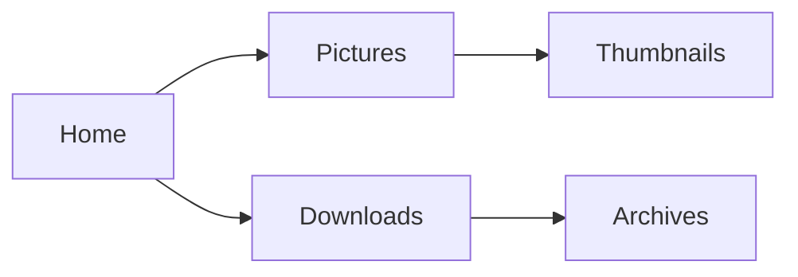

# Welcome to egui-files

A tabbed file browser, running in your browser. Its files are made up and
kept in memory: change anything you like, and a reload puts everything back.

This is a Markdown file in the preview pane, which shows pictures, text and
archives too. It draws diagrams and formulas:



$$\sum_{n=1}^{\infty} \frac{1}{n^2} = \frac{\pi^2}{6}$$

## Things to try

- [ ] Open a few tabs (Ctrl+T), and drag one beside another to split the view.
- [ ] Switch between the list, grid and columns views.
- [ ] Preview a picture or a source file with F3.
- [ ] Look inside the archives in Downloads, and extract one.
- [ ] Copy, rename, trash and restore files.
- [ ] Drop your own files on the page, or use **File → Add files…**. They
      stay in this browser tab: nothing is uploaded.
- [ ] Pick another theme under **View → Theme**.
- [ ] Press **Edit**, under this preview, to change this file.

## What the desktop app adds

| | Demo | Desktop |
|---|:-:|:-:|
| A terminal that follows along | | ✓ |
| Videos, and cutting clips from them | | ✓ |
| Opening files in other apps | | ✓ |
| RAR and zstd archives | | ✓ |
| Phones, drives and servers | | ✓ |

```rust
// Source code is highlighted, too.
fn main() {
    println!("Hello from egui-files!");
}
```


